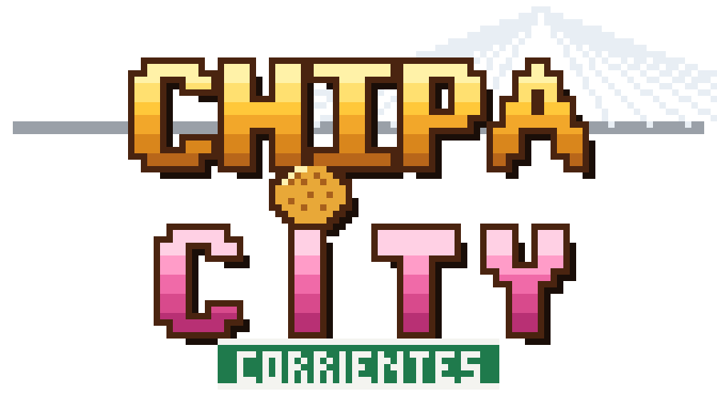

# Chipa City



_(carpeta del proyecto: taragui-turbo)_

Juego top-down estilo 8 bits sobre el **mapa real de Corrientes** (microcentro, Costanera y Puente General Belgrano), con autos, tráfico, peatones y armas. Corre en el navegador, sin instalar nada.

## Jugar

**Online:** https://lauxpress.github.io/chipa-city/ (GitHub Pages, se actualiza solo con cada push a `main`)


- Abrí `game/index.html` con doble clic, **o**
- levantá un servidor: `python -m http.server 8765 --directory game` y entrá a http://localhost:8765

| Tecla | Acción |
|---|---|
| Flechas / WASD | caminar · manejar |
| Enter / F | robar auto · bajarse |
| Espacio | disparar (a pie) · freno de mano (en auto) |
| Q / E | cambiar arma |
| M | mapa de la ciudad |
| N | sonido on/off |
| H | ayuda |

## Policía

Cada delito suma "calor" y prende estrellas (hasta 5):

| Delito | Calor |
|---|---|
| Matar un peatón | +1 |
| Robar un auto con conductor | +0.5 |
| Hacer explotar un auto | +1.5 |
| Robar un patrullero | +2 a +3 |
| Matar a un policía | +3 |
| Volar un patrullero | +4 |

Las estrellas se prenden a 1, 4, 9, 16 y 25 de calor.

- **Patrulleros:** salen fuera de pantalla y te persiguen calculando la ruta (A*) por la red de calles real, sin respetar la mano. De cerca te encaran y te chocan. Hay 1, 2, 3, 5 o 7 según las estrellas, y cada vez son más rápidos.
- **Policías a pie:** cuando el patrullero llega y estás quieto, se bajan dos. Desde 2 estrellas disparan. Si te alcanzan a pie o con el auto parado: **¡TE AGARRÓ LA CANA!** Perdés las armas y el 30% de la plata.
- **Perderlos:** 8 segundos sin ningún policía cerca baja una estrella.

## Regenerar el mapa

```
python tools/fetch_osm.py data/osm_raw.json   # baja los datos de OpenStreetMap (Overpass API)
python tools/fetch_buildings.py               # baja las siluetas de edificios detectadas por satélite (Microsoft)
python tools/fetch_heights.py                 # alturas reales (Google Open Buildings 2.5D, año 2023) — pip install rasterio
python tools/fetch_osm_extra.py               # semáforos y direcciones (numeración de los carteles)
python tools/fetch_wikidata.py                # lugares emblemáticos con foto (para modelarlos de a poco)
python tools/build_map.py                     # genera game/map.js y data/preview.png — pip install shapely
```

Los edificios combinan los ~585 mapeados a mano en OSM con los ~21.800 que Microsoft detectó con IA sobre imágenes
satelitales (Global ML Building Footprints). Lo que queda dentro de cada manzana sin edificar son patios (con árboles y
alguna pileta). Los techos se dibujan con la forma real de cada edificio: chapa, teja, losa o membrana, con tanques de
agua, aires acondicionados y sombras según una altura estimada (más pisos cerca del centro).

El área está definida en `BBOX` en los tres scripts (si la cambiás mucho, revisá también `QUADKEY` en `fetch_buildings.py`). Escala: 1 tile = 2,25 m (12 px).

## Motor 3D

Si el navegador tiene WebGL, el juego se dibuja en 3D con Three.js (incluido en `game/vendor/`, licencia MIT, funciona sin internet):
cámara cenital con perspectiva, edificios levantados con su altura, fachadas pixel art (casas con rejas, comercios con
cartel y persiana, departamentos con balcones, medianeras) y techos con tanques y aires. La lógica del juego sigue en 2D.
Con `#2d` al final de la URL se fuerza el modo plano.

El **Puente General Belgrano** es una estructura propia: tablero elevado (35 m) con rampas, pilas, barandas, sombra sobre
el río y las dos torres con los tensores en abanico. Los autos suben de verdad; la Costanera sigue pasando por debajo.
Las alturas son reales: salen de Google Open Buildings 2.5D (estimadas desde satélite, ~4 m de resolución) o de
`building:levels` en OSM cuando está cargado.

Detalles de la ciudad:
- **Avenidas de doble mano separada** (3 de Abril, Costanera y otras 21): dos carriles por mano con línea blanca,
  parterre con cordón blanco, palmeras y faroles amarillos de doble brazo; el tráfico usa los dos carriles.
- **Puente General Belgrano**: torres en "A" con tensores en abanico, vano central corrido hacia Corrientes,
  pilas cada ~80 m y defensas triangulares rojas en el agua (modelado a mano a partir de una foto de referencia).
- **Pórtico de carteles** en la 3 de Abril antes de Santa Fe ("PROV. DEL CHACO / AV. COSTANERA" y
  "CALLE SANTA FE / CENTRO") y cartel de velocidad máxima.
- **Semáforos amarillos** en los 139 cruces que OSM tiene marcados y faroles en las veredas.
- **Carteles de calle** en pantalla con el diseño municipal (verde, franja blanca), numeración real de OSM y flecha de mano.
- **Manzana Bolívar / Belgrano / Padre Borgatti / Don Bosco** armada a mano: edificios, playón y autos estacionados.

## Edificios emblemáticos

Están en [`game/landmarks.js`](game/landmarks.js): cada ficha se aplica al edificio de OpenStreetMap con ese nombre y define
altura, colores, estilo de fachada (clásico, iglesia, teatro, escuela, ladrillo, moderno, vidrio, paneles, colonial), techo (plano con balaustrada, a dos aguas, a cuatro aguas o bóveda),
estatuas y torres (dobles o única, con cúpula, aguja o pirámide). Las torres se ubican solas en el frente que da a la
calle o a la plaza. Hoy: Casa de Gobierno, Catedral, Teatro Vera, San Francisco, Cruz de los Milagros, Escuela Normal y
La Merced, la vieja Estación (hoy Ministerio de Producción), el Estadio Conte (Regatas), Facultad de Medicina,
Instituto de Cardiología, Rectorado UNNE, FACENA, Mercado Municipal, Gran Hotel Guaraní y Centro Administrativo.
Son interpretaciones propias en pixel art hechas mirando fotos libres de Wikimedia Commons.

Para sumar uno: copiá una ficha, poné el nombre exacto de OSM (`python tools/fetch_wikidata.py` lista lugares con foto).

## Lugares armados a mano

En `tools/build_map.py` hay lugares dibujados desde capturas de referencia, ubicados con tres esquinas reales de OSM
medidas sobre la imagen: la manzana del trabajo (Bolívar / Belgrano / Padre Borgatti / Don Bosco) y la casa en Guido Spano
y Vélez Sarsfield con su reja, palmera y arboleda, la chimenea de ladrillo de la fábrica vieja con sus cimientos y el
edificio de departamentos de enfrente. También la Costanera sur (Marriott sobre Lavalle con su podio curvo, la Torre Ribera
con sus dos láminas y la corona, y la torre de vidrio con voladizo más al sur, con la playa entre la avenida y el río) y
La Unidad (la ex cárcel: muralla de ladrillo con almenas y torreones, el portón, el panóptico en cruz con la pirámide de
vidrio, el edificio del CIT y la torre "vela" con el techo en diagonal).

## Tránsito

- **Colectivos** rojos y blancos (un diseño por línea, con número y ramal en el techo) que recorren las líneas
  104, 105, 108 y 109: los recorridos están en [`data/colectivos.txt`](data/colectivos.txt) y `tools/routes.py` los
  convierte en caminos sobre la red de calles (empareja nombres aunque estén abreviados). Paran cada tanto.
- **Autos** comunes, camionetas, deportivos rápidos, **motos** y un deportivo negro con una Z en el techo (diseño
  propio). Cada tipo tiene su velocidad, aceleración y agarre.
- La IA sigue el carril con "persecución pura" (apunta a un punto un poco más adelante), así no pega saltos.
- **Tendidos de cables**: postes de madera con cables colgando a un costado de las calles y cruzándolas.

## Estructura

- `tools/fetch_osm.py`: descarga calles, edificios, plazas, río y puente.
- `tools/fetch_buildings.py`: descarga las siluetas de edificios de Microsoft para el área.
- `tools/build_map.py`: rasteriza todo a una grilla de tiles, más la red vial (con mano única/doble) para el tráfico.
- `game/render3d.js`: motor 3D (edificios, fachadas, puente, sprites).
- `game/game.js`: lógica del juego (canvas): render por chunks, física arcade de autos con derrape, IA de tráfico, peatones, armas, explosiones y sonido sintetizado.

Mapa © OpenStreetMap contributors (ODbL). Edificios © Microsoft, Global ML Building Footprints (ODbL).
Alturas: Google Open Buildings 2.5D Temporal (CC BY 4.0). Lugares: Wikidata (CC0).
